<p align="center">
  
</p>

<h1 align="center">IDEA SUPPORT</h1>

<p align="center">Company Website &amp; Content Management System</p>

<p align="center"><strong>Version 1.0.0 · In Development · Proprietary</strong></p>

IDEA SUPPORT Website adalah platform company profile dengan situs publik dan
admin panel untuk mengelola konten perusahaan.

| Project | Details |
|---|---|
| Platform | Web application |
| Technology | Next.js, PostgreSQL, Redis, Docker |
| License | [IDEA SUPPORT Proprietary License (ISPL) v1.0](LICENSE.md) |
| Access | Private repository; authorized contributors only |

## Table of Contents

1. [Project Overview](#1-project-overview)
2. [Website Structure](#2-website-structure)
3. [Technology Stack](#3-technology-stack)
4. [Architecture Principles](#4-architecture-principles)
5. [Development Setup](#5-development-setup)
6. [Environment Variables](#6-environment-variables)
7. [Coding Standards and Best Practices](#7-coding-standards-and-best-practices)
8. [Authentication and Authorization](#8-authentication-and-authorization)
9. [Git Workflow](#9-git-workflow)
10. [Commit Convention](#10-commit-convention)
11. [Pull Request and Code Review](#11-pull-request-and-code-review)
12. [Testing and Quality Assurance](#12-testing-and-quality-assurance)
13. [Security and Data Protection](#13-security-and-data-protection)
14. [Performance and SEO](#14-performance-and-seo)
15. [Release Management](#15-release-management)
16. [Documentation Requirements](#16-documentation-requirements)
17. [Definition of Done](#17-definition-of-done)
18. [Development Principles](#18-development-principles)

---

## 1. Project Overview

IDEA SUPPORT Website merupakan platform company profile yang terdiri dari landing page publik dan admin panel untuk mengelola seluruh konten website.

Sistem dirancang dengan Next.js, PostgreSQL, Redis, dan Docker. Arsitektur harus modular, aman, mudah dipelihara, dan dapat dikembangkan tanpa merombak keseluruhan aplikasi setiap kali ada fitur baru.

### Project Objectives

- Menyediakan website resmi IDEA SUPPORT.
- Menampilkan layanan dan kompetensi perusahaan.
- Menampilkan portofolio proyek sebagai bukti kemampuan tim.
- Mengelola berita, profil perusahaan, klien, dan informasi kontak melalui admin panel.
- Menyediakan sistem pengelolaan konten tanpa harus mengubah source code setiap kali konten diperbarui.
- Mendukung deployment menggunakan Docker.
- Menjaga konsistensi kualitas kode melalui standar pengembangan dan code review.

## 2. Website Structure

### 2.1 Public Website

Halaman yang dapat diakses oleh pengunjung tanpa autentikasi.

| Page | Route | Description |
|---|---|---|
| Beranda | `/` | Informasi utama dan ringkasan perusahaan |
| Layanan | `/layanan` | Daftar layanan dan detail layanan |
| Portofolio | `/portofolio` | Daftar proyek dan studi kasus |
| Detail Portofolio | `/portofolio/[slug]` | Detail proyek tertentu |
| Berita | `/berita` | Artikel dan pembaruan perusahaan |
| Detail Berita | `/berita/[slug]` | Isi artikel |
| Tentang Kami | `/tentang-kami` | Profil, visi, misi, dan tim |
| Kontak | `/kontak` | Informasi kontak dan formulir pesan |

### 2.2 Homepage Content Sections

Urutan section dapat disesuaikan berdasarkan hasil desain UI/UX.

1. Hero section
2. Pengenalan IDEA SUPPORT
3. Layanan unggulan
4. Portofolio pilihan
5. Klien kami
6. Keunggulan perusahaan
7. Berita terbaru
8. Call to Action
9. Footer dan informasi kontak

**Keputusan konten:** Portofolio menjadi halaman khusus utama. Klien Kami menjadi section pendukung di beranda. Keduanya tetap memiliki entitas dan pengelolaan data yang terpisah.

### 2.3 Admin Panel

Admin panel digunakan untuk mengelola konten yang ditampilkan pada public website.

| Module | Responsibilities |
|---|---|
| Dashboard | Ringkasan konten dan aktivitas pengelolaan |
| Klien Kami | CRUD data klien, logo, deskripsi, dan status publikasi |
| Portofolio | CRUD proyek, gambar, kategori, studi kasus, dan slug |
| Layanan | CRUD layanan dan detail informasi layanan |
| Berita | CRUD artikel, gambar, kategori, dan publikasi |
| Tentang Kami | Pengaturan profil, visi, misi, dan informasi tim |
| Kontak | Informasi kontak perusahaan dan pesan masuk |
| Media | Pengelolaan file dan aset media jika modul ini diaktifkan |
| Pengaturan | Pengaturan website, metadata, dan konfigurasi konten |
| Admin & Access | Pengelolaan akun dan hak akses administrator |

CRUD berarti Create, Read, Update, dan Delete.

Admin panel wajib menerapkan validasi input, otorisasi, serta konfirmasi untuk tindakan yang berisiko menghapus data.

## 3. Technology Stack

### 3.1 Core Technologies

| Technology | Purpose |
|---|---|
| Next.js | Framework utama untuk public website dan admin panel |
| React | Komponen antarmuka |
| TypeScript | Type safety dan maintainability |
| PostgreSQL | Database relasional utama |
| Redis | Cache dan kebutuhan ephemeral yang memang diperlukan |
| Docker | Containerization aplikasi dan layanan pendukung |
| Docker Compose | Pengelolaan environment lokal dan deployment sederhana |
| Node.js | Runtime aplikasi Next.js |
| Git | Version control |
| GitHub | Repository, pull request, dan code review |

### 3.2 UI and Styling

Gunakan satu sistem desain yang konsisten di seluruh aplikasi.

- Gunakan komponen UI reusable.
- Gunakan desain responsif untuk desktop, tablet, dan mobile.
- Gunakan design tokens untuk warna, spacing, radius, typography, dan elevation.
- Gunakan skeleton loading ketika konten membutuhkan waktu untuk dimuat.
- Sediakan empty state, error state, dan feedback untuk aksi pengguna.
- Pastikan navigasi keyboard dan kontras warna dapat diakses.
- Hindari duplikasi komponen dan styling yang tidak konsisten.

Pilihan library UI, icon, form, validasi, dan data fetching harus ditetapkan setelah audit kebutuhan proyek. Jangan memasang dependency hanya karena sedang populer.

### 3.3 Database and Cache

**PostgreSQL** menjadi sumber data utama dan satu-satunya sumber kebenaran untuk konten persisten.

**Redis** digunakan jika terdapat kebutuhan konkret seperti:

- Cache hasil query atau data publik yang sering dibaca.
- Rate limiting.
- Penyimpanan sementara dengan TTL.
- Session atau kebutuhan ephemeral lain jika arsitektur autentikasi memerlukannya.

Redis bukan pengganti PostgreSQL. Data konten yang harus bertahan tidak boleh hanya disimpan di cache.

### 3.4 Infrastructure

Seluruh layanan harus dapat dijalankan secara konsisten melalui konfigurasi Docker Compose.

Layanan yang direncanakan:

- `web`: Next.js public website dan admin panel.
- `db`: PostgreSQL.
- `redis`: Redis.
- `migrate`: proses migrasi database jika diperlukan sebagai service terpisah.

Reverse proxy dan HTTPS dapat ditambahkan sesuai kebutuhan deployment.

Gunakan Docker named volumes untuk data persisten. Jangan menyimpan data database hanya di filesystem container yang bisa hilang saat container dibuat ulang.

## 4. Architecture Principles

Arsitektur harus mengikuti prinsip berikut:

1. **Separation of Concerns** — setiap modul memiliki tanggung jawab yang jelas.
2. **Single Source of Truth** — data persisten dikelola melalui PostgreSQL.
3. **Reusable Components** — komponen yang digunakan berulang tidak dibuat ulang tanpa alasan.
4. **Type Safety** — gunakan TypeScript dan validasi data di batas sistem.
5. **Secure by Default** — autentikasi, otorisasi, validasi, dan pengelolaan rahasia menjadi bagian desain awal.
6. **Maintainability** — kode harus mudah dipahami oleh developer lain.
7. **Scalability** — modul dapat dikembangkan tanpa coupling yang tidak perlu.
8. **Performance** — gunakan rendering, caching, dan optimasi berdasarkan kebutuhan nyata.
9. **Accessibility** — UI dapat digunakan oleh berbagai pengguna.
10. **Documentation** — perubahan arsitektur dan keputusan penting harus terdokumentasi.

### Recommended Application Structure

Struktur berikut merupakan baseline. Sesuaikan dengan hasil audit repository jika proyek sudah memiliki struktur yang berjalan.

```text
idea-support-website/
├── public/
│   ├── images/
│   ├── icons/
│   └── fonts/
├── src/
│   ├── app/
│   │   ├── (public)/
│   │   ├── (admin)/
│   │   ├── api/
│   │   ├── layout.tsx
│   │   └── globals.css
│   ├── components/
│   │   ├── ui/
│   │   ├── layout/
│   │   └── shared/
│   ├── features/
│   │   ├── clients/
│   │   ├── portfolio/
│   │   ├── services/
│   │   ├── news/
│   │   ├── about/
│   │   └── contact/
│   ├── lib/
│   │   ├── db/
│   │   ├── redis/
│   │   ├── auth/
│   │   └── validations/
│   ├── server/
│   ├── types/
│   └── config/
├── database/
│   ├── migrations/
│   └── seeds/
├── docs/
│   ├── PRD.md
│   ├── ARCHITECTURE.md
│   ├── DATABASE.md
│   ├── SECURITY.md
│   └── ADR/
├── scripts/
├── tests/
├── docker-compose.yml
├── Dockerfile
├── .env.example
├── .gitignore
├── CLAUDE.md
├── CONTRIBUTING.md
├── CHANGELOG.md
├── LICENSE
└── README.md
```

Catatan: struktur folder tidak harus diikuti secara kaku jika framework atau kebutuhan proyek memerlukan pendekatan lain. Konsistensi dan batas tanggung jawab lebih penting daripada jumlah folder.

## 5. Development Setup

### Requirements

Pastikan perangkat pengembangan memiliki:

- Git
- Node.js versi LTS yang kompatibel dengan versi Next.js yang dipilih
- npm atau package manager yang ditetapkan repository
- Docker Engine atau Docker Desktop
- Docker Compose

### Installation

Clone repository:

```bash
git clone <REPOSITORY_URL>
cd idea-support-website
```

Salin konfigurasi environment:

```bash
cp .env.example .env
```

Isi konfigurasi lokal sesuai kebutuhan. Jangan memasukkan kredensial produksi ke file environment lokal.

Jalankan layanan:

```bash
docker compose up -d --build
```

Jalankan migrasi database menggunakan perintah yang disediakan proyek.

Jika aplikasi juga mendukung development mode di luar container:

```bash
npm ci
npm run dev
```

Perintah terakhir dijalankan jika dependensi dan layanan database dapat diakses dari host.

Jangan menjalankan dua instance aplikasi pada port yang sama.

### Useful Docker Commands

```bash
# Melihat status container
docker compose ps

# Melihat log seluruh layanan
docker compose logs -f

# Melihat log aplikasi
docker compose logs -f web

# Menghentikan layanan
docker compose down

# Membangun ulang aplikasi
docker compose up -d --build
```

Perintah `docker compose down -v` akan menghapus named volumes yang terkait. Jangan menjalankannya pada environment berisi data penting tanpa backup dan konfirmasi.

## 6. Environment Variables

Sediakan `.env.example` sebagai referensi konfigurasi.

Contoh variabel:

```dotenv
NODE_ENV=development

DATABASE_URL=postgresql://app_user:local_password@db:5432/idea_support

REDIS_URL=redis://redis:6379

AUTH_SECRET=replace_with_a_secure_random_secret

NEXT_PUBLIC_SITE_URL=http://localhost:3000
```

Ketentuan:

- `.env` tidak boleh di-commit.
- `.env.example` hanya berisi nama variabel dan nilai placeholder.
- Gunakan kredensial khusus untuk setiap environment.
- Secret produksi disimpan melalui environment deployment atau secret manager.
- Variabel `NEXT_PUBLIC_*` dianggap dapat diketahui browser.
- Validasi environment variables ketika aplikasi mulai dijalankan.
- Jangan pernah mengekspos database URL atau secret melalui client-side code.

Nama variabel di atas merupakan contoh awal dan harus disesuaikan dengan library serta konfigurasi yang benar-benar digunakan.

## 7. Coding Standards and Best Practices

### General Rules

- Gunakan TypeScript dengan konfigurasi strict yang sesuai.
- Hindari `any` kecuali memiliki alasan teknis yang terdokumentasi.
- Gunakan nama variabel, fungsi, dan komponen yang jelas.
- Satu fungsi harus memiliki tanggung jawab yang terukur.
- Hindari duplikasi business logic.
- Jangan membuat abstraksi kompleks sebelum ada kebutuhan nyata.
- Jangan menyimpan secret, password, atau token di source code.
- Jangan mengubah kontrak API atau struktur database secara sembarangan.
- Hindari penggunaan `console.log` untuk debugging yang tertinggal di production.
- Jangan menonaktifkan lint, type checking, atau test untuk meloloskan build.

### Next.js Rules

- Utamakan Server Components untuk halaman yang tidak memerlukan interaksi client.
- Gunakan Client Components hanya ketika diperlukan, misalnya state interaktif atau event browser.
- Gunakan Route Handlers atau Server Actions sesuai kebutuhan dan pola arsitektur yang ditetapkan.
- Validasi input di server, bukan hanya melalui form di browser.
- Terapkan autentikasi dan otorisasi pada setiap operasi yang dilindungi.
- Jangan menganggap route yang tidak ditampilkan di UI otomatis aman.
- Gunakan metadata yang sesuai untuk SEO.
- Optimalkan gambar dan font sesuai kemampuan framework.
- Hindari fetch berulang dan query database yang tidak diperlukan.
- Terapkan pagination pada daftar data yang berpotensi bertambah besar.

### Database Rules

- Gunakan migration untuk setiap perubahan skema.
- Jangan mengubah skema produksi secara manual tanpa migration yang dapat direproduksi.
- Gunakan foreign key, unique constraint, dan index sesuai kebutuhan.
- Gunakan transaksi untuk operasi yang perlu konsistensi.
- Terapkan pagination dan filter di query database, bukan hanya di frontend.
- Pisahkan seed development dari data produksi.
- Pertimbangkan soft delete hanya jika kebutuhan bisnis memerlukannya.
- Jangan menghapus atau mengubah data penting tanpa aturan retensi yang jelas.

### Redis Rules

- Tetapkan TTL untuk cache yang memang perlu kedaluwarsa.
- Tentukan strategi invalidasi cache ketika konten berubah.
- Cache harus dapat dibuat ulang dari sumber data utama.
- Jangan mengandalkan cache sebagai satu-satunya penyimpanan konten persisten.
- Jangan memasukkan data rahasia ke cache tanpa kontrol akses dan perlindungan yang sesuai.

## 8. Authentication and Authorization

Admin panel harus dilindungi autentikasi.

Persyaratan minimum:

- Password disimpan menggunakan password hashing yang aman.
- Session atau token dikelola melalui mekanisme yang sesuai.
- Operasi admin divalidasi berdasarkan hak akses di server.
- Terapkan proteksi terhadap brute force dan penyalahgunaan endpoint.
- Cookie autentikasi menggunakan konfigurasi keamanan yang sesuai, termasuk `HttpOnly`, `Secure` pada HTTPS, dan kebijakan `SameSite`.
- Terapkan proteksi CSRF sesuai mekanisme autentikasi dan jenis request.
- Validasi upload file, ukuran file, dan tipe file.
- Catat aktivitas sensitif jika diperlukan untuk audit.
- Hindari menampilkan detail internal server dalam pesan error kepada pengguna.

Jika hanya ada satu jenis administrator pada versi awal, jangan membangun sistem role yang rumit tanpa kebutuhan. Namun, struktur otorisasi tetap harus memungkinkan pengembangan role di kemudian hari.

## 9. Git Workflow

Gunakan pemisahan branch untuk development dan release.

### Branch Structure

| Branch | Purpose |
|---|---|
| `main` | Kode produksi atau baseline stabil yang sudah dirilis |
| `development` | Integrasi fitur yang sedang dikembangkan |
| `feature/*` | Pengembangan fitur baru |
| `fix/*` | Perbaikan bug |
| `hotfix/*` | Perbaikan mendesak untuk produksi |
| `release/*` | Persiapan rilis, jika diperlukan |

Branch `main` tidak boleh menjadi tempat eksperimen fitur.

### Workflow for New Features

1. Pastikan perubahan yang akan dibuat sudah dipahami.
2. Sinkronkan branch `development`.
3. Buat branch fitur baru.
4. Implementasikan fitur sesuai scope.
5. Tambahkan atau perbarui test.
6. Jalankan lint, type checking, test, dan build.
7. Commit perubahan menggunakan format yang disepakati.
8. Push branch ke remote.
9. Buat Pull Request menuju `development`.
10. Lakukan code review.
11. Selesaikan semua temuan penting sebelum merge.
12. Setelah development stabil, siapkan rilis melalui release branch atau mekanisme rilis yang disepakati.
13. Merge rilis yang sudah tervalidasi ke `main` dan buat tag versi.

### Example Commands

```bash
git switch development
git pull origin development

git switch -c feature/portfolio-management

# Implementasikan perubahan

git add src/features/portfolio
git commit -m "feat(portfolio): add portfolio management"

git push -u origin feature/portfolio-management
```

Buat Pull Request dari:

`feature/portfolio-management` → `development`

Jangan langsung melakukan push ke `main` untuk perubahan fitur normal.

## 10. Commit Convention

Gunakan format Conventional Commits:

```text
<type>(<scope>): <description>
```

Gunakan deskripsi singkat, spesifik, dan berbentuk tindakan.

### Commit Types

| Type | Purpose |
|---|---|
| `feat` | Menambahkan fitur baru |
| `fix` | Memperbaiki bug |
| `refactor` | Merapikan struktur tanpa mengubah perilaku yang dimaksud |
| `perf` | Meningkatkan performa |
| `docs` | Perubahan dokumentasi |
| `style` | Perubahan formatting yang tidak memengaruhi logika |
| `test` | Menambah atau memperbaiki test |
| `build` | Perubahan build system atau dependency |
| `ci` | Perubahan pipeline CI/CD |
| `chore` | Pemeliharaan umum |
| `revert` | Membatalkan commit sebelumnya |

### Examples

Menambahkan modul portofolio:

```bash
git commit -m "feat(portfolio): add portfolio management"
```

Memperbaiki validasi form kontak:

```bash
git commit -m "fix(contact): validate contact form input"
```

Memperbarui dokumentasi:

```bash
git commit -m "docs(readme): document local development setup"
```

Menambahkan migration:

```bash
git commit -m "feat(database): add portfolio tables"
```

Memperbaiki cache invalidation:

```bash
git commit -m "fix(cache): invalidate portfolio cache on update"
```

Memperbarui dependency:

```bash
git commit -m "build(deps): update compatible dependencies"
```

### Commit Rules

- Satu commit sebaiknya mewakili satu perubahan yang logis.
- Jangan mencampur fitur, refactor besar, dan perbaikan bug yang tidak berkaitan.
- Jangan menggunakan pesan seperti `update`, `fix`, `changes`, atau `final`.
- Jangan memasukkan file `.env`, secret, database dump sensitif, atau file build.
- Jangan melakukan amend atau force push pada commit bersama tanpa koordinasi.
- Pisahkan perubahan migration dari perubahan data manual yang tidak terdokumentasi.
- Jika perubahan memengaruhi kontrak API atau database, jelaskan dampaknya dalam Pull Request.

## 11. Pull Request and Code Review

Setiap Pull Request wajib memuat:

- Tujuan perubahan.
- Ringkasan implementasi.
- Modul atau halaman yang terdampak.
- Bukti pengujian.
- Screenshot untuk perubahan UI.
- Migration atau perubahan environment jika ada.
- Risiko kompatibilitas dan langkah deployment jika relevan.

### Review Checklist

- [ ] Perubahan sesuai scope.
- [ ] Tidak ada secret atau kredensial.
- [ ] Validasi input berjalan di server.
- [ ] Hak akses telah diperiksa.
- [ ] Tidak ada query atau request berulang yang tidak perlu.
- [ ] Loading, empty, success, dan error state ditangani.
- [ ] UI responsif dan dapat diakses.
- [ ] Test relevan telah ditambahkan atau diperbarui.
- [ ] Lint, type check, dan build berhasil.
- [ ] Migration dan dokumentasi diperbarui jika diperlukan.

Pull Request tidak boleh di-merge hanya karena aplikasi terlihat berjalan di komputer developer.

## 12. Testing and Quality Assurance

Gunakan strategi pengujian bertingkat:

- **Unit test:** fungsi, utilitas, dan business logic.
- **Integration test:** database, validasi, dan alur server.
- **End-to-end test:** alur utama pengunjung dan administrator.
- **Build verification:** memastikan aplikasi dapat dibangun untuk production.

Prioritaskan pengujian pada:

- Login dan akses admin.
- CRUD setiap modul.
- Validasi form kontak.
- Upload dan pengelolaan media.
- Publikasi serta pembatalan publikasi konten.
- Slug dan halaman detail.
- Cache invalidation.
- Migration database.
- Error handling dan authorization.

Jangan menganggap test berhasil hanya karena proses test tidak menampilkan error yang terlihat. Pastikan assertion benar-benar memverifikasi perilaku yang diharapkan.

## 13. Security and Data Protection

- Gunakan prinsip least privilege untuk database dan akun admin.
- Batasi akses database dari jaringan publik.
- Jangan mengekspos port PostgreSQL dan Redis ke internet tanpa kebutuhan dan kontrol keamanan yang kuat.
- Gunakan HTTPS untuk production.
- Terapkan validasi dan sanitasi input sesuai konteks.
- Cegah SQL injection melalui query terparameterisasi atau ORM yang digunakan dengan benar.
- Lindungi upload dari file berbahaya dan path traversal.
- Gunakan rate limiting untuk endpoint yang berisiko disalahgunakan.
- Sediakan backup database terjadwal dan uji proses pemulihannya.
- Jangan mencatat password, token, atau informasi rahasia dalam log.
- Perbarui dependency berdasarkan kompatibilitas, changelog, dan kebutuhan keamanan.
- Terapkan kebijakan akses repository serta lisensi internal IDEA SUPPORT.

## 14. Performance and SEO

Public website harus mengutamakan performa dan aksesibilitas.

- Gunakan rendering server untuk halaman yang sesuai.
- Tentukan strategi caching berdasarkan jenis konten.
- Gunakan pagination untuk daftar berita dan portofolio.
- Optimalkan ukuran gambar dan font.
- Sediakan metadata unik pada halaman penting.
- Gunakan canonical URL jika diperlukan.
- Sediakan sitemap dan robots configuration.
- Hindari mengirimkan library besar ke browser tanpa alasan.
- Jangan melakukan caching data admin atau data privat sebagai konten publik.
- Ukur performa sebelum menerapkan optimasi yang kompleks.

## 15. Release Management

Gunakan Semantic Versioning:

```text
MAJOR.MINOR.PATCH
```

Contoh:

- `1.0.0`: rilis awal.
- `1.1.0`: penambahan fitur yang kompatibel.
- `1.1.1`: perbaikan bug.
- `2.0.0`: perubahan besar yang tidak kompatibel.

Sebelum rilis:

1. Pastikan Pull Request sudah direview.
2. Jalankan test dan production build.
3. Verifikasi environment production.
4. Pastikan migration dan backup siap.
5. Uji alur autentikasi serta konten publik.
6. Catat perubahan dalam `CHANGELOG.md`.
7. Buat tag versi.
8. Deploy dan verifikasi health aplikasi.
9. Siapkan prosedur rollback.

Jangan menjalankan migration destruktif tanpa backup dan rencana pemulihan yang jelas.

## 16. Documentation Requirements

Dokumentasi proyek minimal mencakup:

| Document | Content |
|---|---|
| `README.md` | Overview dan setup proyek |
| `CONTRIBUTING.md` | Aturan kontribusi dan Git workflow |
| `CLAUDE.md` | Panduan kerja AI coding agent jika menggunakan AI |
| `docs/PRD.md` | Kebutuhan dan ruang lingkup produk |
| `docs/ARCHITECTURE.md` | Arsitektur dan batas modul |
| `docs/DATABASE.md` | Skema dan relasi database |
| `docs/SECURITY.md` | Kebijakan keamanan |
| `docs/ADR/` | Keputusan arsitektur penting |
| `CHANGELOG.md` | Riwayat perubahan versi |
| [`LICENSE.md`](LICENSE.md) | Ketentuan penggunaan dan kepemilikan |

Setiap keputusan arsitektur yang berdampak luas harus didokumentasikan melalui Architecture Decision Record (ADR).

## 17. Definition of Done

Sebuah fitur dianggap selesai apabila:

- Implementasi sesuai kebutuhan dan scope.
- Tidak merusak fitur yang sudah berjalan.
- Validasi, autentikasi, dan otorisasi diterapkan sesuai kebutuhan.
- Test yang relevan lulus.
- Lint, type checking, dan production build lulus.
- UI memiliki loading, empty, success, dan error state sesuai konteks.
- Migration dan konfigurasi diperbarui jika diperlukan.
- Dokumentasi relevan telah diperbarui.
- Pull Request sudah direview dan disetujui.
- Perubahan dapat dijalankan ulang oleh developer lain mengikuti dokumentasi.

## 18. Development Principles

Seluruh contributor wajib mengikuti prinsip berikut:

1. Audit sebelum mengubah sistem yang sudah ada.
2. Pahami kebutuhan sebelum menambahkan dependency.
3. Prioritaskan solusi sederhana yang memenuhi kebutuhan.
4. Jangan membuat fitur di luar scope tanpa persetujuan.
5. Jangan melakukan refactor besar tanpa alasan yang jelas.
6. Jangan menyembunyikan error dengan menonaktifkan validasi atau test.
7. Jangan mengubah database production secara langsung.
8. Jangan mengklaim fitur telah selesai sebelum diverifikasi.
9. Dokumentasikan perubahan yang berdampak pada contributor lain.
10. Utamakan keamanan, konsistensi, dan maintainability daripada kecepatan sesaat.

---

---

Maintained by IDEA SUPPORT. This README defines the baseline development
conventions; implementation decisions should remain consistent with the actual
repository architecture.

Use of this repository is subject to the
[IDEA SUPPORT Proprietary License (ISPL) v1.0](LICENSE.md).
